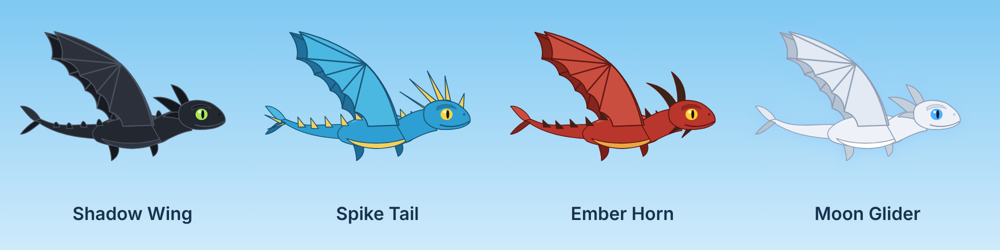

# Dragon Flyby for Home Assistant

Every 15 minutes a dragon swoops across your Home Assistant dashboard. It stays on screen for no more than 5 seconds, flies over everything, and doesn't change anything on the dashboard underneath it.



The dragons are original artwork inspired by the films *How to Train Your Dragon*: big wings, big eyes, a cheeky blast of fire or plasma halfway across.

| Dragon | Style | Breath |
| --- | --- | --- |
| Shadow Wing (`shadow`) | Sleek, jet black, green eyes | Purple plasma |
| Spike Tail (`spike`) | Blue, horned crown, spiked tail | White-hot blast |
| Ember Horn (`ember`) | Red, curved horns, spiny back | Flame |
| Moon Glider (`moon`) | Pale and glowing, ice-blue eyes | Blue-white plasma |

## Install

[](https://my.home-assistant.io/redirect/supervisor_add_addon_repository/?repository_url=https%3A%2F%2Fgithub.com%2Fdongasaurus%2FslopDragon)

1. In Home Assistant go to **Settings → Add-ons → Add-on Store**.
2. Open the **⋮** menu → **Repositories**, add `https://github.com/dongasaurus/slopDragon` and close the dialog.
3. Find **Dragon Flyby**, click **Install**, then **Start**.
4. Refresh your dashboard (on a wall tablet, reload the page).

The add-on installs the dragon, then stops. **Seeing "stopped" afterwards is normal.** The dragon runs in your browser, so nothing has to stay running. It starts again by itself each time Home Assistant boots.

> If the log says the `www` folder was just created, restart Home Assistant once so it starts serving the dragon file.

## Options

| Option | Default | What it does |
| --- | --- | --- |
| `enabled` | `true` | Turn this off and start the add-on again to remove the dragon. |
| `interval_minutes` | `15` | Minutes between flights (1 to 1440). |
| `duration_seconds` | `5` | Seconds each flight lasts (1 to 5, never more than 5). |
| `dragon` | `random` | `random`, `shadow`, `spike`, `ember` or `moon`. |
| `size` | `medium` | `small`, `medium` or `large`. |
| `dashboards_only` | `true` | Only fly over dashboards, not over Settings or other pages. |
| `fly_on_load` | `false` | Also send a dragon a few seconds after a dashboard opens. Handy for testing. |

After changing options, start the add-on again and refresh your dashboards.

## How it works

- The add-on copies `dragon-flyby.js` to `/config/www/dragon-flyby/` and adds it as a dashboard resource (**Settings → Dashboards → ⋮ → Resources**). The options go in the resource URL.
- In the browser, the script waits for the interval, then adds one overlay element on top of the page. The overlay ignores taps and clicks, so everything underneath keeps working, and it's isolated in a shadow root, so it can't restyle anything. It's removed as soon as the flight ends.
- It skips a flight when the tab is hidden, when you're not on a dashboard (if `dashboards_only` is on), or when the device asks for reduced motion.
- Each browser has its own timer, so every open dashboard gets its own dragon.

Want a dragon right now? Open your browser's developer console on a dashboard and run `dragonFlyby.fly()` or `dragonFlyby.fly("ember")`.

## Without the add-on store

On Home Assistant Container or Core (no add-ons), install it by hand:

1. Copy [`dragon_flyby/www/dragon-flyby.js`](dragon_flyby/www/dragon-flyby.js) to `/config/www/dragon-flyby/dragon-flyby.js`.
2. Go to **Settings → Dashboards → ⋮ → Resources → Add resource**.
3. URL: `/local/dragon-flyby/dragon-flyby.js?interval=15&duration=5`, type **JavaScript module**.

Use the same options in the URL: `interval`, `duration`, `dragon`, `size`, `dashboards` (`1`/`0`) and `onload` (`1`/`0`).

If your resources are managed in YAML:

```yaml
lovelace:
  resources:
    - url: /local/dragon-flyby/dragon-flyby.js?interval=15&duration=5
      type: module
```

## Development

Preview the dragons without Home Assistant:

```bash
python3 -m http.server 8000
```

Then open http://localhost:8000/demo/ and use the buttons.

Run the tests:

```bash
pip install websockets && python3 -m unittest discover tests
```

```bash
node --test tests/frontend.test.cjs
```

The browser tests need Node 18+ and Playwright with Chromium.

## Credits

Original artwork and code. Inspired by DreamWorks Animation's *How to Train Your Dragon*. This project isn't affiliated with or endorsed by DreamWorks.
