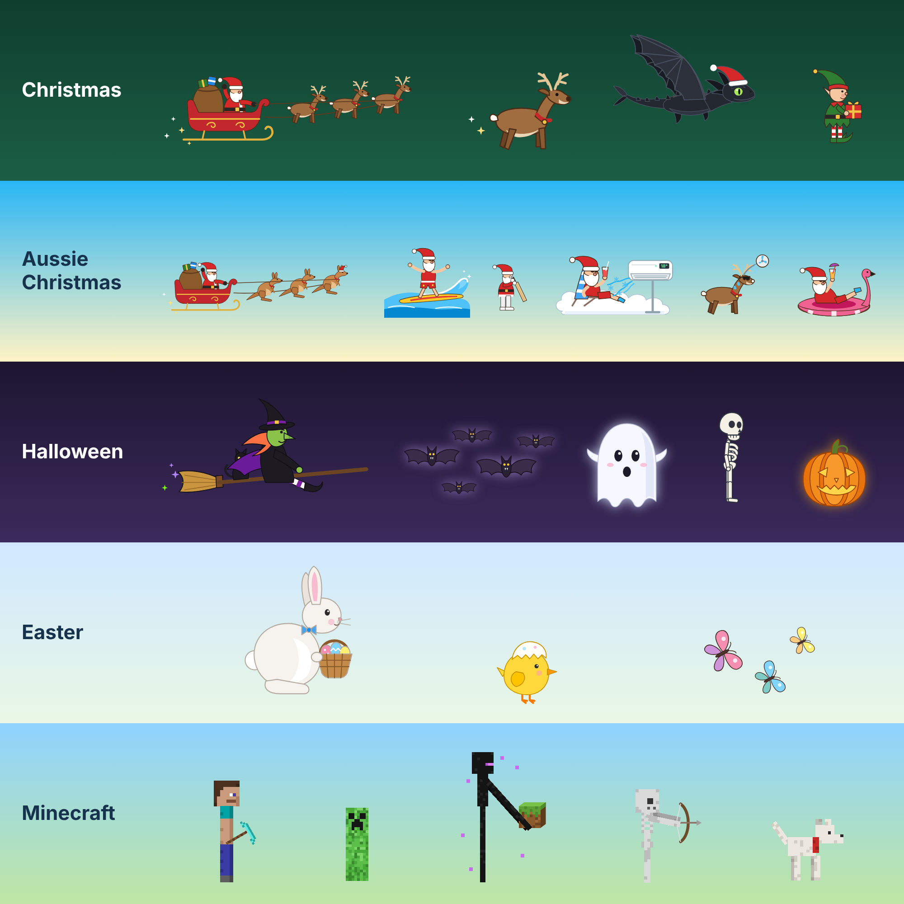

# Dragon Flyby for Home Assistant

Every 15 minutes a dragon swoops across your Home Assistant dashboard. Or, with a holiday theme, Santa's sleigh, a surfing Santa, a witch, a skeleton or the Easter bunny. It stays on screen for 5 seconds (configurable up to 10), flies over everything, and doesn't change anything on the dashboard underneath it.


The dragons are original artwork inspired by the films *How to Train Your Dragon*: big wings, big eyes, a cheeky blast of fire or plasma halfway across.

| Dragon | Style | Breath |
| --- | --- | --- |
| Shadow Wing (`shadow`) | Sleek, jet black, green eyes | Purple plasma |
| Spike Tail (`spike`) | Blue, horned crown, spiked tail | White-hot blast |
| Ember Horn (`ember`) | Red, curved horns, spiny back | Flame |
| Moon Glider (`moon`) | Pale and glowing, ice-blue eyes | Blue-white plasma |

## Themes

Set the `theme` option to swap the dragons for seasonal or Minecraft visitors. They follow the same interval and duration.



| Theme | Who shows up |
| --- | --- |
| `christmas` | Santa's sleigh and reindeer fly by ("Ho ho ho!"), a lone reindeer gallops across the sky, a dragon flies by in a Santa hat, an elf walks along the bottom carrying a present. |
| `australianchristmas` | Christmas in an Aussie summer: Santa's sleigh pulled by hopping kangaroos ("G'day!"), Santa surfing a wave along the bottom, Santa in cricket pads and zinc cream running between the wickets ("Yes! Run!"), Santa cooling off in a deckchair in front of the air conditioner ("Ahhh, bliss!"), a reindeer in sunnies cooling off with a fan, Santa drifting past on a flamingo pool floatie with a cold drink, and the dragon in a Santa hat. |
| `halloween` | A witch on her broomstick (with her cat) and a swarm of bats fly by, a ghost floats past ("BOO!"), a skeleton walks and a jack-o'-lantern hops along the bottom. |
| `easter` | The Easter bunny hops along the bottom with a basket of eggs, a chick in its eggshell waddles past, butterflies flutter by. |
| `minecraft` | Blocky pixel-art visitors walking along the bottom: Steve with a diamond pickaxe, a creeper that flashes and hisses ("Sssss...", it never explodes), an enderman carrying a grass block that teleports mid-walk, a skeleton archer that fires an arrow, and Denis the dog ("Woof!"). Not part of `auto`. |
| `auto` | Follows the calendar: Halloween all of October, Christmas all of December (the Australian one if Home Assistant is set to Australia), Easter from a week before Easter Sunday to Easter Monday, dragons the rest of the year. |

## The unicorn


Whatever the theme, every visit has a small chance (5% by default) of being a unicorn instead, galloping across the sky with a rainbow trail. Set `unicorn_chance` between `0` (never) and `25`.

## Install

[](https://my.home-assistant.io/redirect/supervisor_add_addon_repository/?repository_url=https%3A%2F%2Fgithub.com%2Fdongasaurus%2FslopDragon)

1. In Home Assistant go to **Settings → Add-ons → Add-on Store**.
2. Open the **⋮** menu → **Repositories**, add `https://github.com/dongasaurus/slopDragon` and close the dialog.
3. Find **Dragon Flyby**, click **Install**, then **Start**.
4. Refresh your dashboard (on a wall tablet, reload the page).

The add-on installs the dragon, then stops. **Seeing "stopped" afterwards is normal.** The dragon runs in your browser, so nothing has to stay running. It starts again by itself each time Home Assistant boots.

> If the log says the `www` folder was just created, restart Home Assistant once so it starts serving the dragon file.

## Options

| Option | Default | What it does |
| --- | --- | --- |
| `enabled` | `true` | Turn this off and start the add-on again to remove the visitors. |
| `interval_minutes` | `15` | Minutes between visits (1 to 1440). |
| `duration_seconds` | `5` | Seconds each visit lasts (1 to 10). |
| `theme` | `dragons` | `dragons`, `christmas`, `australianchristmas`, `halloween`, `easter`, `minecraft` or `auto` (follows the calendar). |
| `unicorn_chance` | `5` | Percent chance (0 to 25) that a unicorn flies by instead of the usual visitor, in every theme. `0` turns it off. |
| `dragon` | `random` | Optional, hidden under **Show unused optional configuration options**. Picks one dragon for the `dragons` theme (and `auto` outside the holidays): `random`, `shadow`, `spike`, `ember` or `moon`. |
| `size` | `medium` | `small`, `medium`, `large` or `extralarge`. |
| `dashboards_only` | `true` | Only show visitors on dashboards, not on Settings or other pages. |
| `fly_on_load` | `false` | Also send a visitor a few seconds after a dashboard opens. Handy for testing. |

After changing options, start the add-on again and refresh your dashboards.

## How it works

- The add-on copies `dragon-flyby.js` to `/config/www/dragon-flyby/` and adds it as a dashboard resource (**Settings → Dashboards → ⋮ → Resources**). The options go in the resource URL.
- In the browser, the script waits for the interval, then adds one overlay element on top of the page. The overlay ignores taps and clicks, so everything underneath keeps working, and it's isolated in a shadow root, so it can't restyle anything. It's removed as soon as the flight ends.
- It skips a flight when the tab is hidden, when you're not on a dashboard (if `dashboards_only` is on), or when the device asks for reduced motion.
- Each browser has its own timer, so every open dashboard gets its own dragon.

Want one right now? Open your browser's developer console on a dashboard and run:

- `dragonFlyby.fly()` for a visitor from the current theme
- `dragonFlyby.fly("halloween")` for a random visitor from a theme
- `dragonFlyby.fly("sleigh")` for a specific one (`dragonFlyby.characters` lists them all)

## Without the add-on store

On Home Assistant Container or Core (no add-ons), install it by hand:

1. Copy [`dragon_flyby/www/dragon-flyby.js`](dragon_flyby/www/dragon-flyby.js) to `/config/www/dragon-flyby/dragon-flyby.js`.
2. Go to **Settings → Dashboards → ⋮ → Resources → Add resource**.
3. URL: `/local/dragon-flyby/dragon-flyby.js?interval=15&duration=5`, type **JavaScript module**.

Use the same options in the URL: `interval`, `duration`, `theme`, `dragon`, `size`, `dashboards` (`1`/`0`) and `onload` (`1`/`0`).

If your resources are managed in YAML:

```yaml
lovelace:
  resources:
    - url: /local/dragon-flyby/dragon-flyby.js?interval=15&duration=5
      type: module
```

## Development

Preview the dragons without Home Assistant:

```bash
python3 -m http.server 8000
```

Then open http://localhost:8000/demo/ and use the buttons to summon any theme or character.

Run the tests:

```bash
pip install websockets && python3 -m unittest discover tests
```

```bash
node --test tests/frontend.test.cjs
```

The browser tests need Node 18+ and Playwright with Chromium.

## Credits

Original artwork and code. The dragons are inspired by DreamWorks Animation's *How to Train Your Dragon*. This project isn't affiliated with or endorsed by DreamWorks.

The `minecraft` theme is fan art. Minecraft is a trademark of Mojang Synergies AB, and this project isn't affiliated with or endorsed by Mojang or Microsoft.
